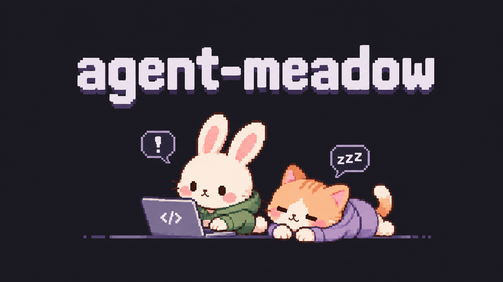

# Agent Meadow · AI 에이전트의 작업 상태를 보여주는 VS Code 도트 펫

Codex와 Claude Code의 작업 상태를 도트 캐릭터로 보여주는 VS Code 확장 프로그램입니다. 하단 패널의 캐릭터가 작업·대기·완료 상태를 표현하고, 승인이나 답변이 필요하면 말풍선과 알림으로 알려 줍니다.

## 설치

1. VS Code에서 명령 팔레트 (`⌘⇧P`) → **Extensions: Install from VSIX…**.
2. `dist/agent-meadow-0.1.0.vsix` 선택.
3. 작업 폴더를 열고 **Agent Meadow: 정원 열기** 실행.
4. **데모**로 캐릭터를 먼저 만나거나 **＋ Codex / ＋ Claude**로 실제 작업을 시작하세요.

패널은 터미널과 같은 하단 영역에 나타납니다. 패널의 위쪽 경계를 내려 작은 띠처럼 사용할 수 있습니다. 상태 표시줄 위의 전용 패널이며, 에디터나 다른 앱 위를 떠다니는 오버레이는 아닙니다. 데모는 명확히 DEMO로 표시되며 실제 승인 요청이나 시스템 알림을 보내지 않습니다.

## 실제 연결

### Claude Code

Claude Code CLI가 설치·로그인되어 있어야 합니다. `＋ Claude`는 별도 터미널을 만들고 그 세션에만 관찰용 Hook 설정을 전달합니다. 기존 전역/프로젝트 설정 파일을 수정하지 않습니다. 기본 PATH 또는 macOS의 `~/.local/bin/claude`를 찾으며, 다른 위치라면 `agentMeadow.claudePath`에 실행 파일 경로를 지정하세요.

도구 실행, 계획 검토(ExitPlanMode), 질문(AskUserQuestion), 권한 요청, 완료와 하위 에이전트 이벤트를 반영합니다. 말풍선을 누르면 해당 터미널을 엽니다. 승인과 답변은 Claude 터미널에서 직접 합니다. Hook은 결정을 반환하거나 자동 승인하지 않습니다. Hook 비활성화 정책을 적용한 환경에서는 연결할 수 없습니다.

### Codex

Codex CLI가 설치·로그인되어 있어야 합니다. `agentMeadow.codexPath`에 실행 파일 경로를 지정할 수 있습니다. `＋ Codex`에서 요청을 입력하면 `codex app-server` 세션을 시작합니다. 각 작업은 새 스레드이며 작업 폴더 범위의 sandbox와 `on-request` 승인 정책을 사용합니다.

승인 말풍선을 누르면 명령/파일 변경 요청을 검토한 뒤 이번만 허용 또는 거절할 수 있습니다. 질문은 선택지 또는 텍스트로 답합니다. 창을 닫아도 자동 승인되지 않습니다. 응답과 진행 기록은 **출력 → Agent Meadow**에 표시됩니다. 추가 권한 부여·MCP 입력 등 아직 지원하지 않는 서버 요청은 오류로 응답하여 허용하지 않습니다. 이 초기 버전은 기존 공식 Codex 확장/데스크톱 앱의 열린 대화를 자동 감시하거나 이어받지 않습니다.

## 선택 대기 알림

- 분홍 말풍선과 `!` 표시, 상태 표시줄의 **확인 필요**가 실제 대기가 해제될 때까지 유지됩니다.
- VS Code 알림의 **확인하기**는 해당 세션으로 연결됩니다.
- macOS에서 VS Code가 비활성화되어 있으면 AppleScript 시스템 알림도 요청합니다. OS 알림 권한/집중 모드에 따라 전달 여부가 달라집니다. macOS 시스템 알림 자체에는 대화 딥링크가 없습니다. VS Code로 돌아와 정원을 열어 주세요.
- Windows/Linux에서는 현재 VS Code 내부 알림만 지원합니다. 원격 확장 호스트에서는 로컬 macOS 알림을 보장하지 않습니다.
- 같은 대기 상태를 반복 알리지 않습니다. 연결 종료 시에는 수면 상태로 바뀝니다.

## 개발 / 검증

이 폴더를 VS Code에서 열고 F5 → Extension Development Host. Node 20 이상이면 `npm test` (외부 설치 없음), Python 3이면 `python3 scripts/package.py`로 VSIX를 생성합니다.

데이터 수집이나 분석 전송은 없습니다. Claude 이벤트 수신기는 임의 포트의 `127.0.0.1`에만 바인딩하고 실행 인스턴스별 인증 토큰과 세션 ID를 검사합니다. Hook은 프롬프트/명령 본문을 보내지 않습니다. Codex 출력은 VS Code 출력 창에 표시됩니다. 실제 모델 사용은 각 도구의 로그인·사용량 정책을 따릅니다.

참고: [Codex App Server](https://learn.chatgpt.com/docs/app-server), [Claude Code Hooks](https://code.claude.com/docs/en/hooks), [VS Code Webview](https://code.visualstudio.com/api/extension-guides/webview).

## 이번 빌드의 검증 범위

상태 전환 3개, 실제 로컬 HTTP Hook 전달 1개, 모의 Codex 서버 왕복 통신 1개 테스트가 통과했습니다. JavaScript 구문 검사도 통과했습니다. 실제 VS Code 화면 렌더링, 로그인된 Codex/Claude의 모델 실행, macOS 알림 전달은 이 환경에서 아직 검증하지 않았습니다. `dist/preview.html`은 브라우저에서 열 수 있는 독립 애니메이션 데모입니다.
