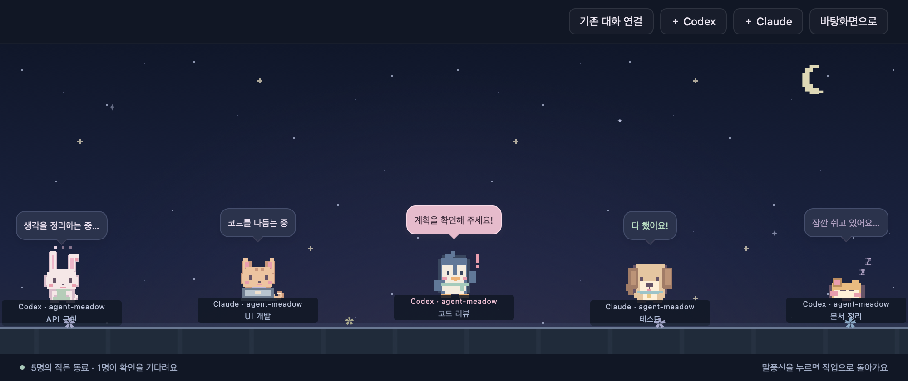
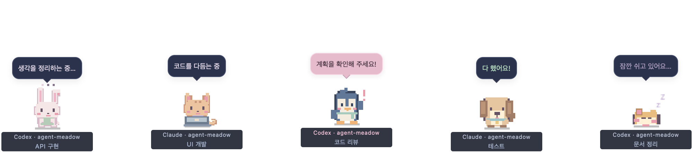

# Agent Meadow · 내 AI 에이전트를 도트 캐릭터로

Codex와 Claude Code의 작업 상태를 귀여운 도트 캐릭터로 보여주는 VS Code 확장 프로그램입니다. VS Code 하단 패널에서 함께하거나, macOS 화면 하단으로 보내 다른 앱을 쓰면서도 상태를 확인할 수 있습니다.



*현재 UI를 렌더링한 캡처입니다. 프로젝트·역할과 상태는 기능 설명을 위한 예시이며, 실제 사용 시 연결한 에이전트만 표시됩니다.*

- **캐릭터 5종:** 토끼 · 고양이 · 펭귄 · 강아지 · 햄스터
- **작업 상태:** 작업·생각·선택 대기·완료·수면을 표정과 말풍선으로 표시
- **기존 대화 연결:** 현재 작업 폴더의 로컬 Codex·Claude Code 기록을 읽기 전용으로 연결
- **바탕화면 산책:** macOS에서 우클릭으로 VS Code 밖에 꺼내기

기존 대화 연결은 기록 기반 추정이므로 모든 승인 대기를 감지하지는 못합니다. 아래 연결 방식별 범위를 확인하세요.

## 설치

1. VS Code에서 명령 팔레트 (`⌘⇧P`) → **Extensions: Install from VSIX…**.
2. `dist/agent-meadow-0.2.4.vsix` 선택.
3. 업데이트했다면 **Developer: Reload Window** 실행.
4. 작업 폴더를 열고 **Agent Meadow: 정원 열기** 실행.
5. **기존 대화 연결**로 대화를 선택하거나 **＋ Codex / ＋ Claude**로 새 작업을 시작하세요.

VS Code 1.95 이상이 필요합니다. 새 작업을 시작하려면 해당 도구의 CLI 설치·로그인이 필요하며, 기존 대화 연결에는 해당 작업 폴더의 로컬 대화 기록이 있어야 합니다.

패널은 터미널과 같은 하단 영역에 나타납니다. 패널의 위쪽 경계를 내려 작은 띠처럼 사용할 수 있습니다. 데모 버튼은 없으며, 연결한 세션과 해당 세션의 도우미만 표시됩니다.

## macOS 바탕화면 동료



*동반 앱의 투명 UI를 렌더링한 예시 상태 캡처입니다. 실제 사용 시 이 투명 영역 뒤로 바탕화면이나 사용 중인 앱이 보입니다.*

캐릭터를 우클릭(트랙패드 두 손가락 클릭 또는 Control+클릭)하고 **바탕화면으로 보내기**를 선택하면 화면 하단(Dock 위)에서 산책합니다. 다른 앱을 쓰거나 VS Code 창을 최소화해도 연결된 에이전트의 말풍선이 표시됩니다. 보낸 캐릭터는 VS Code 패널에서 빠지고 바탕화면에 표시됩니다. 다른 캐릭터를 추가하거나 돌려보내도 이미 있는 캐릭터의 위치·이동 방향·속도·쉬는 시간은 유지됩니다. 빈 공간은 클릭이 통과하며, 캐릭터·말풍선·이름표 영역은 마우스 입력을 받습니다.

- 우클릭 대신 상단 **바탕화면으로** 버튼이나 명령 팔레트의 **Agent Meadow: 바탕화면으로 보내기**에서 에이전트를 선택할 수도 있습니다.
- 말풍선 클릭: VS Code의 해당 에이전트 확인 화면으로 이동합니다. 기존 대화 연결은 원래 대화에서 답변·승인해야 합니다.
- 캐릭터 클릭: VS Code에서 캐릭터를 변경합니다.
- 바탕화면 캐릭터 우클릭: **VS Code로 돌려보내기** 또는 **모두 돌려보내고 닫기**.
- 명령 팔레트의 **Agent Meadow: 바탕화면 동료 모두 돌려보내기**로도 복귀할 수 있습니다.

macOS 14 이상, Apple Silicon/Intel용 동반 실행 파일을 포함합니다. 로컬 macOS에서 실행하는 VS Code를 대상으로 합니다. 처음에는 기본 화면 하단에 나타나고, 드래그해서 화면 안의 원하는 위치로 옮길 수 있습니다. VS Code를 종료하거나 창을 다시 로드하면 동반 앱도 종료됩니다. 기존 대화의 상태는 로컬 기록에 기반하므로 승인 감지에는 기존 제한이 그대로 적용됩니다. 캐릭터를 바탕화면에 보낸 위치는 재시작 후 유지하지 않습니다.

동반 앱은 확장과 로컬 프로세스 입출력으로 상태를 주고받습니다. 외부 서버 연결이나 화면 녹화·접근성 권한은 사용하지 않습니다. 배포 실행 파일은 로컬 서명이며 Apple 공증을 받지 않았습니다.

## 캐릭터 선택과 옮기기

캐릭터를 꾹 누르거나 드래그하면 살짝 들립니다. 원하는 위치에서 놓으면 그 위치에 내려놓고 잠깐 쉰 뒤 산책을 이어 갑니다. 짧게 클릭하면 캐릭터를 변경합니다. 드래그 후 놓을 때는 캐릭터 변경 창이 열리지 않습니다. 상단의 캐릭터 변경 버튼은 제거했으며, 명령 팔레트의 **Agent Meadow: 캐릭터 변경**도 사용할 수 있습니다. VS Code에서는 패널 안에서, macOS에서는 기본 화면의 Dock·메뉴 막대를 제외한 영역에서 옮길 수 있습니다. 위치는 재시작 후 복원하지 않습니다.


캐릭터를 클릭하거나 키보드로 포커스한 뒤 Enter를 누르면 토끼·고양이·펭귄·강아지·햄스터 중 선택할 수 있습니다. 모든 캐릭터는 산책·작업·생각·승인 대기·완료·수면 상태를 표현합니다. 말풍선은 기존처럼 작업 확인용입니다. 기존 대화에 지정한 캐릭터는 같은 작업 공간에서 다시 연결해도 유지됩니다. 새 세션은 기본 캐릭터로 시작합니다.

토끼는 접힌 귀 끝과 크림색 털, 고양이는 이마 줄무늬와 말린 꼬리로 표현됩니다. 두 캐릭터 모두 작은 점눈과 단순한 얼굴, 몸 안쪽에 모은 앞발과 편안한 수면 자세로 표현됩니다.

## 프로젝트 이름

캐릭터 이름은 `Claude · agent-meadow`처럼 실행 프로젝트 폴더명을 표시합니다. 같은 프로젝트에서 같은 종류를 추가하면 `#2`, `#3` 번호가 붙습니다. 열린 파일에서 가장 가까운 Git·Node·Python 등의 프로젝트 루트를 찾고, 없으면 작업 폴더를 사용합니다. 여러 작업 폴더 중 현재 파일로 판단할 수 없으면 선택 창을 표시합니다. 이름이 길면 줄여 표시하며 마우스를 올리면 전체 이름을 볼 수 있습니다.

프로젝트명 아래에 현재 작업도 표시합니다. Codex는 입력한 요청, Claude는 가장 최근 요청의 첫 줄을 짧게 표시하고, Claude 도우미는 제공된 역할명(예: Explore, Plan)을 표시합니다. 이는 AI가 추론한 요약이 아닌 요청 미리보기이며, 긴 내용은 24자에서 줄입니다.

## 에이전트 자동 추가·정리

- 이 확장에서 시작한 세션마다 캐릭터가 추가됩니다.
- Claude 하위 에이전트는 시작 이벤트에서 나타나고 종료 이벤트에서 사라집니다. 부모 세션을 닫으면 도우미도 함께 정리됩니다.
- Claude는 답변을 마쳐도 세션이 열려 있으면 쉬고, 세션 종료 또는 터미널 닫기 시 사라집니다.
- Codex 단일 작업은 완료 상태를 12초간 보여준 뒤 프로세스와 캐릭터를 정리합니다. 연결 실패·종료 시에는 즉시 사라집니다.
- 모든 캐릭터는 가로 스크롤 없이 화면 안에 배치됩니다. 쉬는 중·완료 상태에서는 각자 가까운 목적지를 골라 걷고 잠깐 쉬며, 중간에서도 방향을 바꿉니다. 출발과 도착 시 속도가 부드럽게 변하고 이동 방향을 바라보며 서로 지나칠 수 있습니다. 마우스를 올리거나 키보드로 포커스하면 멈춰서 선택하기 쉽습니다.
- 기존 공식 확장의 대화는 아래의 읽기 전용 연결로 선택할 수 있습니다. 새 하위 에이전트를 자동으로 전부 연결하지는 않습니다.

## 기존 대화 연결 (실험적)

**기존 대화 연결** 버튼에서 현재 작업 폴더의 Codex·Claude Code 대화를 여러 개 선택할 수 있습니다. 원래 앱의 대화를 재개하거나 수정하지 않고, 로컬 JSONL 기록을 3초마다 읽어 캐릭터로 표시합니다. 프로젝트명과 대화 제목·작업명을 두 줄로 표시합니다. 세션 ID는 연결 선택 목록에서만 표시합니다. 기존 대화의 사용자 요청 문장은 이름으로 사용하지 않습니다. 연결할 때 찾은 대화 제목을 고정하고, 제목이 없으면 `연결된 대화`로 표시합니다. 말풍선 → **이름 설정**에서 프로젝트명과 역할(예: UI 개발, 코드 리뷰)을 지정할 수 있고, 이름 설정은 같은 작업 공간에 저장됩니다. 상위 작업 폴더로 기록된 대화는 현재 열린 파일의 프로젝트를 표시 기본값으로 사용하므로 필요하면 이름 설정으로 바로잡으세요.

- 기본 검색 위치: `~/.codex/sessions`, `~/.claude/projects`. `CODEX_HOME`과 `CLAUDE_CONFIG_DIR`도 지원합니다.
- 최근 150개 기록 중 현재 VS Code 작업 폴더에 속한 대화를 찾습니다. 로컬 기록이 없는 웹·클라우드 대화는 지원하지 않습니다.
- 기록 기반 추정이므로 실제 앱의 활성 여부, 모든 승인 대기, 생각 중 상태를 정확히 알 수는 없습니다. 2분간 관련 기록이 없으면 상태 미확인으로 표시하며 자동 승인 알림은 보내지 않습니다.
- 기존 대화의 답변과 승인은 원래 앱에서 진행하세요. 말풍선을 누르면 연결을 해제할 수 있습니다. 로그 파일이 삭제되면 캐릭터도 제거됩니다. 앱 종료 여부는 로그만으로 판별하지 못합니다.
- VS Code를 다시 로드하면 연결을 다시 선택해야 합니다. 선택한 대화 기록은 읽기 전용으로 처리하며 외부 서버로 전송하지 않습니다.
- 비공식 로컬 기록 형식에 의존하므로 도구 업데이트 시 호환성 수정이 필요할 수 있습니다.

## 실제 연결

### Claude Code

Claude Code CLI가 설치·로그인되어 있어야 합니다. `＋ Claude`는 별도 터미널을 만들고 그 세션에만 관찰용 Hook 설정을 전달합니다. 기존 전역/프로젝트 설정 파일을 수정하지 않습니다. 기본 PATH 또는 macOS의 `~/.local/bin/claude`를 찾으며, 다른 위치라면 `agentMeadow.claudePath`에 실행 파일 경로를 지정하세요.

도구 실행, 계획 검토(ExitPlanMode), 질문(AskUserQuestion), 권한 요청, 완료와 하위 에이전트 이벤트를 반영합니다. 말풍선을 누르면 해당 터미널을 엽니다. 승인과 답변은 Claude 터미널에서 직접 합니다. Hook은 결정을 반환하거나 자동 승인하지 않습니다. Hook 비활성화 정책을 적용한 환경에서는 연결할 수 없습니다.

### Codex

Codex CLI가 설치·로그인되어 있어야 합니다. `agentMeadow.codexPath`에 실행 파일 경로를 지정할 수 있습니다. `＋ Codex`에서 요청을 입력하면 `codex app-server` 세션을 시작합니다. 각 작업은 새 스레드이며 작업 폴더 범위의 sandbox와 `on-request` 승인 정책을 사용합니다.

승인 말풍선을 누르면 명령/파일 변경 요청을 검토한 뒤 이번만 허용 또는 거절할 수 있습니다. 질문은 선택지 또는 텍스트로 답합니다. 창을 닫아도 자동 승인되지 않습니다. 응답과 진행 기록은 **출력 → Agent Meadow**에 표시됩니다. 추가 권한 부여·MCP 입력 등 아직 지원하지 않는 서버 요청은 오류로 응답하여 허용하지 않습니다. 기존 공식 Codex 확장/데스크톱 앱의 대화를 이어받아 실행하지는 않습니다. 기존 대화의 상태 표시에는 **기존 대화 연결**을 사용하세요.

## 선택 대기 알림

- 분홍 말풍선과 `!` 표시, 상태 표시줄의 **확인 필요**가 실제 대기가 해제될 때까지 유지됩니다.
- VS Code 알림의 **확인하기**는 해당 세션으로 연결됩니다.
- macOS에서 VS Code가 비활성화되어 있으면 AppleScript 시스템 알림도 요청합니다. OS 알림 권한/집중 모드에 따라 전달 여부가 달라집니다. macOS 시스템 알림 자체에는 대화 딥링크가 없습니다. VS Code로 돌아와 정원을 열어 주세요.
- Windows/Linux에서는 현재 VS Code 내부 알림만 지원합니다. 원격 확장 호스트에서는 로컬 macOS 알림을 보장하지 않습니다.
- 같은 대기 상태를 반복 알리지 않습니다. 연결 종료 시에는 해당 캐릭터가 사라집니다.

## 개발 / 검증

이 폴더를 VS Code에서 열고 F5로 Extension Development Host를 실행합니다. Node 20 이상, Python 3을 사용하며 외부 npm 의존성은 없습니다.

```bash
npm test                       # 상태·연결·산책·동반 프로세스 테스트
python3 scripts/preview.py      # 빈 패널 디자인 미리보기
python3 scripts/package.py      # dist/agent-meadow-0.2.4.vsix 생성
```

네이티브 앱을 수정했으면 macOS + Xcode Command Line Tools 환경에서 먼저 빌드하세요.

```bash
sh scripts/build-desktop.sh     # Apple Silicon / Intel 실행 파일 생성
python3 scripts/capture.py      # 현재 UI의 README용 캡처 2장 갱신
python3 scripts/package.py
```

캡처 스크립트는 예시 상태를 주입해 macOS WebKit으로 렌더링하며, 실제 대화 기록이나 작업 화면을 읽지 않습니다. 예시 캐릭터는 문서 캡처에만 사용합니다.

데이터 수집이나 분석 전송은 없습니다. Claude 이벤트 수신기는 임의 포트의 `127.0.0.1`에만 바인딩하고 실행 인스턴스별 인증 토큰과 세션 ID를 검사합니다. Hook은 작업 이름 표시를 위해 사용자 요청의 첫 줄을 최대 24자까지 로컬 수신기에 전달합니다. 명령 본문이나 전체 프롬프트는 전달하지 않습니다. Codex 출력은 VS Code 출력 창에 표시됩니다. 실제 모델 사용은 각 도구의 로그인·사용량 정책을 따릅니다.

참고: [Codex App Server](https://learn.chatgpt.com/docs/app-server), [Claude Code Hooks](https://code.claude.com/docs/en/hooks), [VS Code Webview](https://code.visualstudio.com/api/extension-guides/webview).

## 검증 범위와 제한

- JavaScript 테스트 23개: 상태 전환, 로컬 HTTP Hook, 모의 Codex 서버 통신, 기존 대화 파싱, 이름·프로젝트 판별, 캐릭터 이동, 동반 프로세스 연결·종료.
- 실제 macOS WebKit에서 캐릭터 5종 렌더링, 투명 배경, 입력 영역 15개 생성, 상태 목록을 비웠을 때 캐릭터 제거를 확인했습니다.
- Apple Silicon에서 실행을 확인했습니다. Intel용 실행 파일은 함께 빌드했지만 실제 Intel Mac에서는 실행 검증하지 않았습니다.
- 로그인된 모델의 실제 작업, 시스템 알림 전달, 모든 macOS Spaces·전체 화면·다중 모니터 조합은 별도 검증이 필요합니다.
- 창 다시 로드 시 기존 대화를 다시 연결해야 합니다. 다중 모니터 선택과 바탕화면 배치 복원은 아직 지원하지 않습니다.
